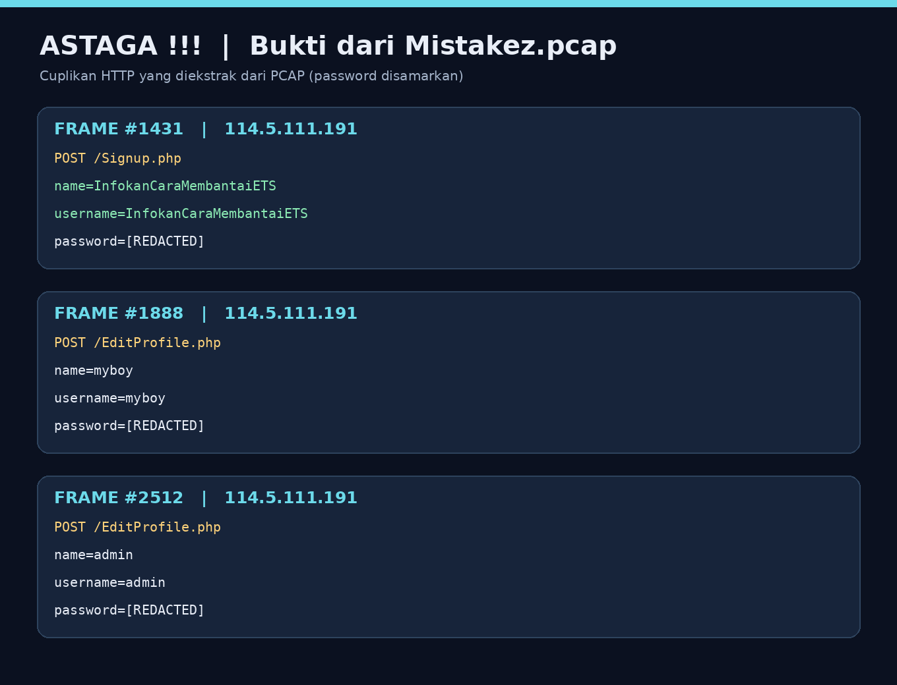
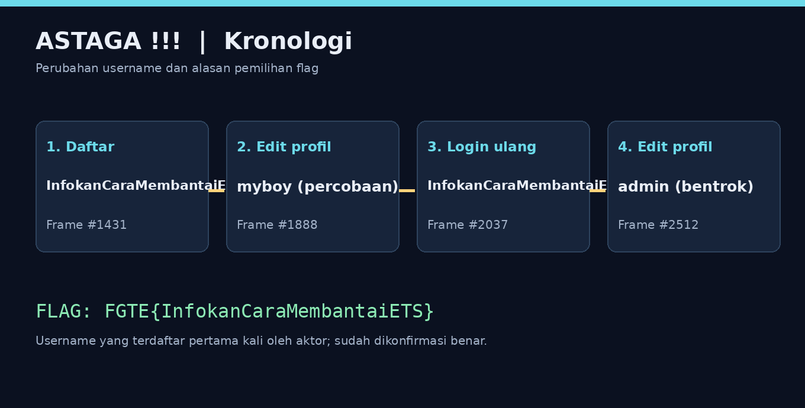

# Astaga !!! — FGTE 2025

| | |
|---|---|
| **Category** | Forensics |
| **Difficulty** | Easy |
| **Author** | Anaknya_Bang_Lodwig (@zuyyy) |
| **File** | [`files/Mistakez.pcap`](files/Mistakez.pcap) |

> keke adalah admin suatu website, namun di suatu hari ia tidak bisa login,
> hal itu terjadi karena keke tidak memeriksa aturan edit profile.
> Tolong bantu keke menemukan nama usernamenya.
>
> Format flag: `FGTE{username}`

**🚩 Flag:** `FGTE{InfokanCaraMembantaiETS}`

---

## Analisis

Buka `Mistakez.pcap` dengan Wireshark. Karena aplikasi menggunakan HTTP, kita dapat melihat request dan body yang berisi username.

Filter yang membantu:

```wireshark
http.request.method == "POST"
```

Untuk fokus ke endpoint registrasi, login dan edit profil:

```wireshark
http.request.uri contains "Signup.php" || http.request.uri contains "EditProfile.php" || http.request.uri contains "Login.php"
```

### Bukti trafik HTTP



Pada **frame #123**, akun admin asli didaftarkan dengan `username=admin` dari IP `103.94.191.125`.

Pada **frame #1431**, IP `114.5.111.191` mendaftarkan akun baru:

```http
POST /Signup.php HTTP/1.1

name=InfokanCaraMembantaiETS&username=InfokanCaraMembantaiETS&password=[REDACTED]&phone=8263618262
```

> `[REDACTED]` adalah penyamaran dalam writeup. Nilai asli terlihat dalam PCAP.

Pada **frame #1888**, pengguna tersebut mencoba mengedit profilnya menjadi `myboy`:

```http
POST /EditProfile.php HTTP/1.1

name=myboy&username=myboy&phone=816371823&password=[REDACTED]&update_profile=
```

Login dengan `myboy` pada **frame #1951** dan **#2007** menerima HTTP `200 OK`, sedangkan login berikutnya menggunakan `InfokanCaraMembantaiETS` pada **frame #2037** mendapat HTTP `302 Found`. Dalam alur aplikasi ini, perbedaan respons tersebut menunjukkan login dengan username lama berhasil, bukan username `myboy`.

Pada **frame #2512**, terjadi request edit profil mencurigakan yang mengubah username menjadi `admin`:

```http
POST /EditProfile.php HTTP/1.1

name=admin&username=admin&phone=8263618262&password=[REDACTED]&update_profile=
```

Login menggunakan `admin` dari IP tersebut pada **frame #2541** menghasilkan `302 Found`. Sementara itu, percobaan login admin asli di **frame #3083** menghasilkan `200 OK` pada halaman login, bukan redirect login sukses.



### Kenapa bukan `FGTE{admin}`?

`admin` adalah username yang digunakan pada tahap bentrok akun / perubahan profil. Flag yang diterima oleh challenge adalah **username awal yang didaftarkan oleh aktor tersebut**, yaitu `InfokanCaraMembantaiETS`.

## Flag

```text
FGTE{InfokanCaraMembantaiETS}
```

**Status:** Sudah dikonfirmasi benar oleh pemain.
