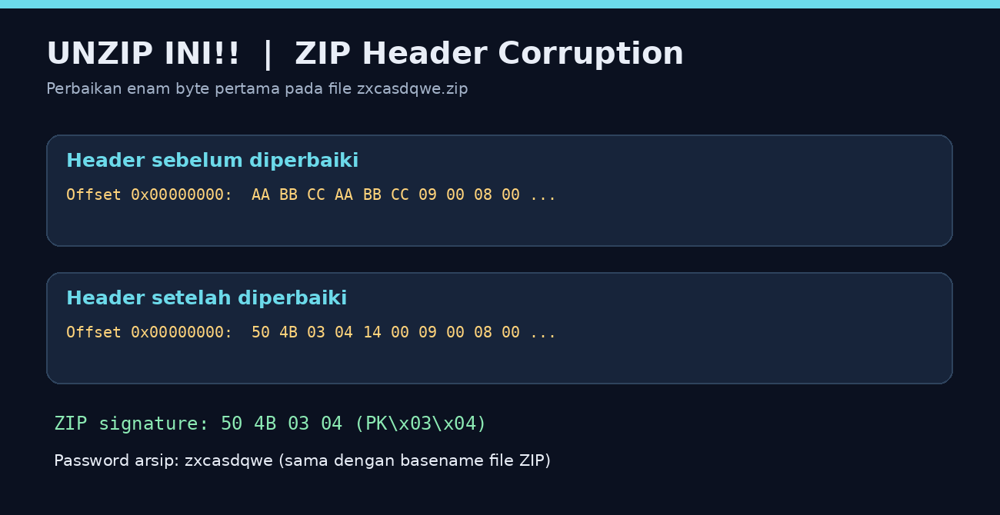
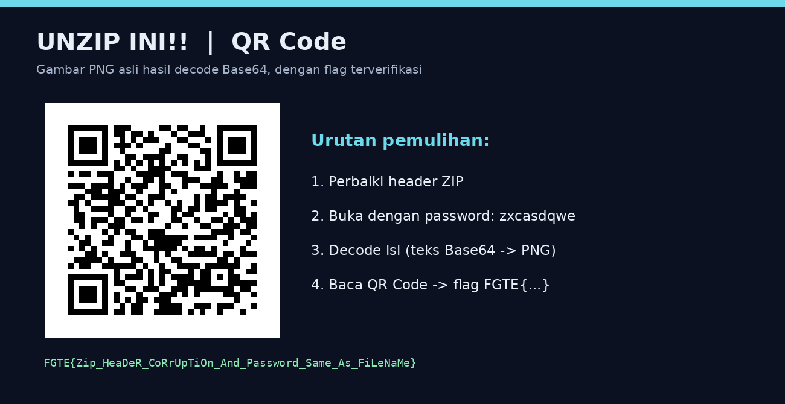

# unzip ini!! — FGTE 2025

| | |
|---|---|
| **Category** | Misc |
| **Difficulty** | Easy |
| **Author** | aria |
| **File** | [`files/zxcasdqwe.zip`](files/zxcasdqwe.zip) |

> unzip ini!!

**🚩 Flag:** `FGTE{Zip_HeaDeR_CoRrUpTiOn_And_Password_Same_As_FiLeNaMe}`

---

## Analisis

Arsip yang terlihat seperti ZIP tidak bisa diekstrak karena **header ZIP-nya sengaja dirusak**.

### Langkah 1 — Periksa hex header

Enam byte pertama file asli adalah:

```text
AA BB CC AA BB CC
```

Header local file ZIP yang normal pada arsip ini seharusnya:

```text
50 4B 03 04 14 00
```



Repair melalui Python:

```python
from pathlib import Path

src = Path("zxcasdqwe.zip").read_bytes()
fixed = bytes.fromhex("50 4B 03 04 14 00") + src[6:]

Path("zxcasdqwe_repaired.zip").write_bytes(fixed)
```

### Langkah 2 — Cek metadata dan password

Sesudah diperbaiki, arsip memiliki entri:

```text
pass_nya_ada_di_metadata_zip_nya!
```

Komentar ZIP juga memuat:

```text
Author: AI
Note: https://pastebin.com/aAEE0ejm
```

Namun password yang benar bisa ditentukan dari **nama file ZIP tanpa ekstensi**, yaitu:

```text
zxcasdqwe
```

### Langkah 3 — Ekstrak dan decode Base64

Konten file dalam arsip adalah string Base64 yang diawali `iVBORw0KGgo...`, tanda umum data PNG dalam bentuk Base64.

Contoh script satu langkah untuk mengekstrak dan menyimpan PNG:

```python
import base64
import zipfile
from pathlib import Path

with zipfile.ZipFile("zxcasdqwe_repaired.zip") as z:
    name = z.namelist()[0]
    encoded_png = z.read(name, pwd=b"zxcasdqwe")

Path("qr.png").write_bytes(base64.b64decode(encoded_png))
print("QR code tersimpan sebagai qr.png")
```

### Langkah 4 — Scan QR


Baca menggunakan QR scanner atau `opencv-python`:

```python
import cv2

img = cv2.imread("qr.png")
flag, points, _ = cv2.QRCodeDetector().detectAndDecode(img)

print(flag)
```

Output:

```text
FGTE{Zip_HeaDeR_CoRrUpTiOn_And_Password_Same_As_FiLeNaMe}
```



## Flag

```text
FGTE{Zip_HeaDeR_CoRrUpTiOn_And_Password_Same_As_FiLeNaMe}
```

**Status:** Diverifikasi langsung dari QR Code hasil ekstraksi ZIP.
